# Digitize Patches

**Turn a picture into a machine embroidery file.** The pipeline separates the colours, builds fills and satin outlines, and writes an editable [Ink/Stitch](https://inkstitch.org) SVG and a VP3 file for Husqvarna and Viking machines. It runs headless: no Inkscape window is needed.

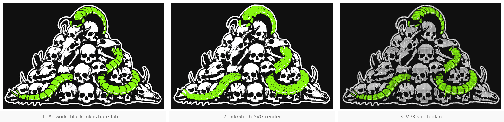

*Scavenger's Daughter, two threads, 259.8 x 168.6 mm, 54,233 stitches. Left to right: the artwork (black ink is the bare fabric), the Ink/Stitch SVG, the VP3 stitch plan. The artwork is by [@thedustydruid](CREDITS.md).*

<p>
  
  
  
  
</p>

---

## What you get

For every picture the pipeline writes:

| File | What it is |
|---|---|
| `output_inkstitch_svg/<name>.svg` | The digitized design. Open it in Inkscape to look at it or change it. |
| `output_vp3/<name>.vp3` | The machine file. |
| `output_vp3/<name>_stitchplan.png` | Every stitch drawn as a thin line, in thread colour. Check the layout without sewing. |
| `output_vp3/<name>_coverage.png` | The same file drawn at real thread width, to judge how well the fabric is covered. |

## What it does

- **Colour separation.** Your picture becomes a few flat thread colours. Pin the exact hex values you own, or let the pipeline pick a palette in CIELAB.
- **Fills with holes.** Each colour becomes closed fill regions. Holes stay open. Specks under a minimum size are dropped.
- **Satin outlines.** Thin runs of the darkest colour are skeletonized into satin columns whose width follows the line. Anything thinner than Ink/Stitch's 1.0 mm satin minimum is widened or dropped, so it is not silently sewn as a running stitch.
- **Satin border.** A transparent background is treated as a patch. The pipeline finds or adds a satin border and draws it last.
- **Seam compensation.** Fills grow 0.6 mm under the layers stitched after them, so a small shift in the fabric does not open a gap. A fabric profile (`--profile vadmel`) sets density, underlay and pull compensation for thick wool.
- **Trims and travel.** A long or exposed jump gets a trim. Jumps under 2 mm are left alone. Where the next object has the same colour and later stitching will cover the way, the needle runs there under that stitching and the thread is not cut. A trim between points 2 mm apart or less is dropped.
- **Layered SVG input.** An Inkscape SVG with named layers goes through a separate path that keeps the artist's stitch order.

## Sewn results

Photos by the author, on black wool, sewn on a Husqvarna/Viking machine.

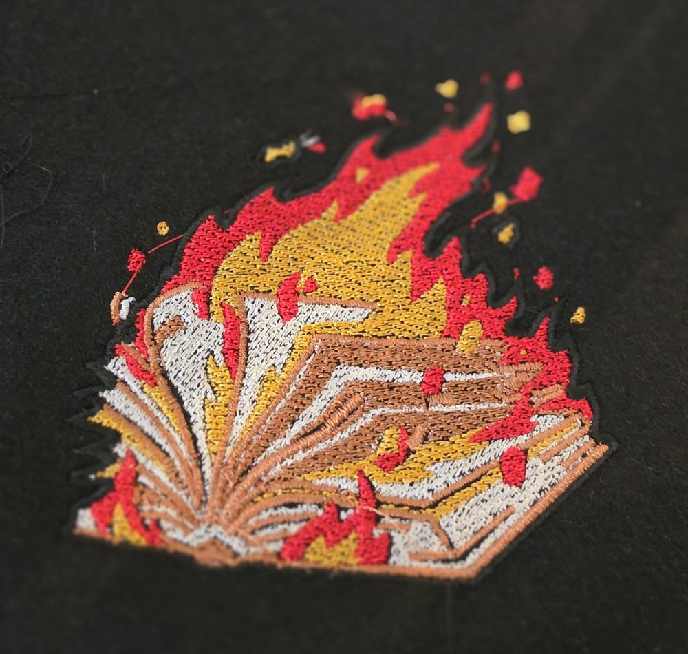

*Book Burner. Red, gold, white, copper and black threads on a black border. A clean sew.*

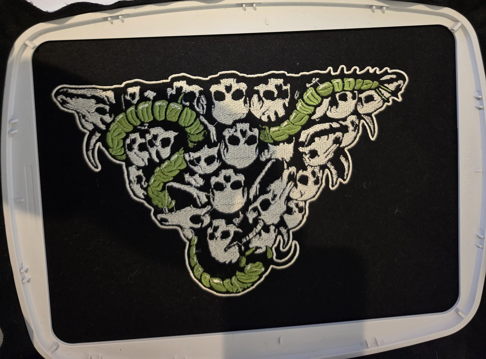

*Scavenger's Daughter in the 260 x 200 mm hoop. The satin on the centipede came out very well. Known problems in this sew: some centipede legs are missing, dense areas jammed the machine, and the white shading on the centipede did not need to be stitched.*

## Gallery

The source images are AI-generated with Google Gemini. Each sheet shows the source, the stitch plan and the coverage render. Numbers come from the VP3 files; the exact command for every image is in [docs/assets/render-manifest.md](docs/assets/render-manifest.md).

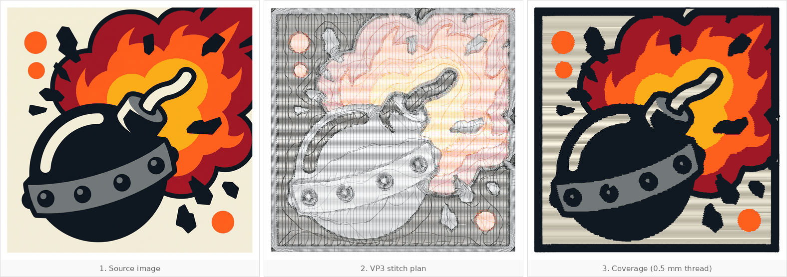

*Bomb: 90.6 x 90.3 mm, 21,864 stitches, 6 threads.*

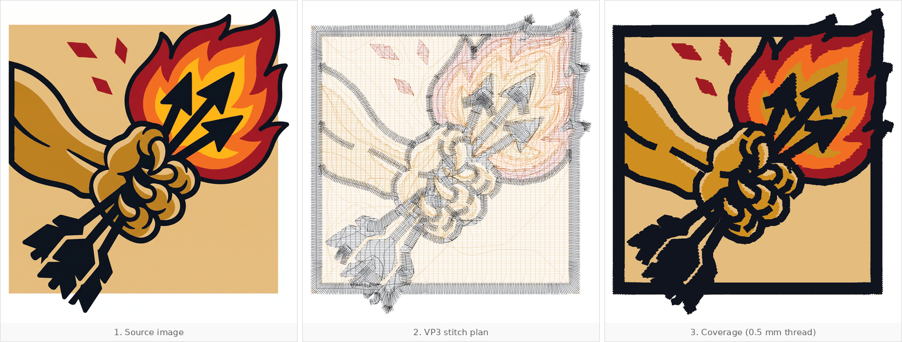

*Skyfowl: 69.5 x 75.8 mm, 17,065 stitches, 5 threads.*

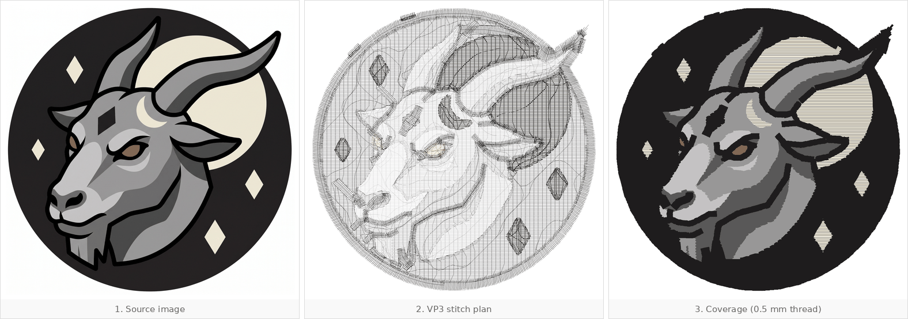

*Midnight Epicure: 80.4 x 80.3 mm, 16,309 stitches, 6 threads.*

<details>
<summary>Four more designs</summary>

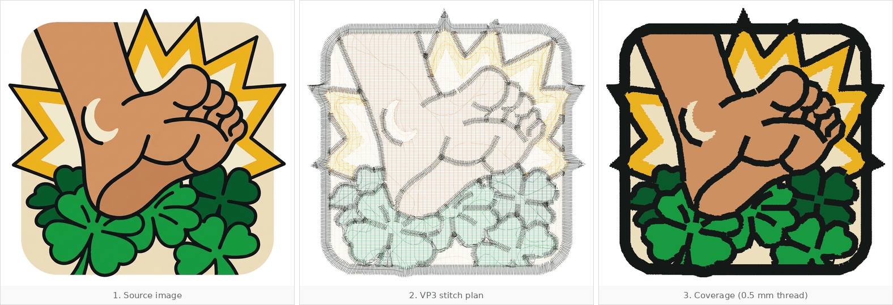

*Four-Leaf Clover: 75.7 x 73.3 mm, 17,503 stitches, 6 threads.*

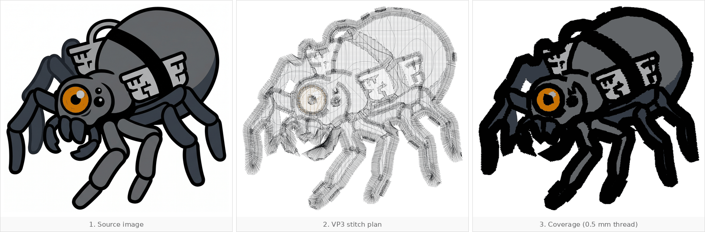

*Reaper Spider: 70.3 x 65.5 mm, 12,509 stitches, 5 threads.*

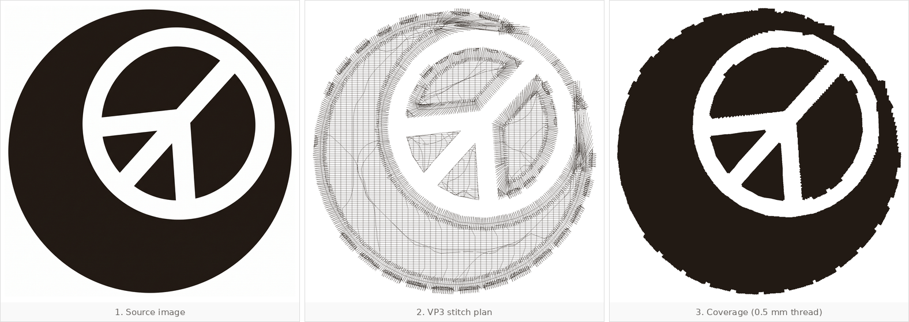

*Peace: 60.8 x 61.4 mm, 7,248 stitches, 1 thread.*

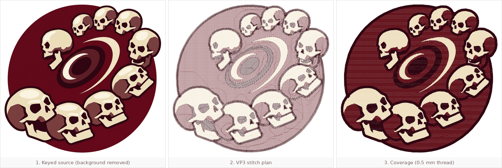

*Back Nine Skulls: 190.5 x 181.3 mm, 61,308 stitches, 4 threads. The source panel is the background-keyed image; no original file exists.*

</details>

## Quick start

```bash
# picture to Ink/Stitch SVG and VP3
tools/digitize/run.sh path/to/image.png

# a patch with a plain background: key it out first, 90 mm wide, 6 colours
tools/digitize/run.sh --key-background --size-mm 90 --colors 6 image.png

# pin your own threads
tools/digitize/run.sh --palette "#1A1A1A,#B5651D,#F2ECD7" image.png
```

`run.sh` takes WebP, PNG and JPG pictures, and layered Inkscape SVG files. Every flag, the YAML config format and the fabric profiles are in [docs/USAGE.md](docs/USAGE.md). Setup needs Python 3.13, the pinned packages and a checkout of Ink/Stitch; the steps are in the same document.

## How it works

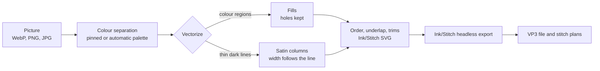

1. **Classify.** A transparent background marks a patch (alpha silhouette plus border). An opaque picture drops its lightest cluster as paper and sends the darkest colour to the outlines.
2. **Denoise and palette.** A median filter, then flat thread colours: your pinned hexes assigned in CIELAB, or an automatic palette bounded by `--colors`.
3. **Vectorize.** Each colour becomes closed fill regions with `evenodd` holes.
4. **Outlines to satin.** Thin runs of the outline colour are skeletonized into centre lines and emitted as satin columns.
5. **Order and trim.** Layers keep their light-to-dark order. Inside a layer the objects are swept nearest-first from the needle position left by the previous layer. Long or exposed jumps get trims.
6. **Export.** The SVG carries the Ink/Stitch parameters for each object and is converted to VP3 headlessly, using a small `wx` stand-in so no GUI toolkit is needed.
7. **Travel under.** In the VP3, each trim between two objects of one colour becomes a running stitch hidden under later fills, satin or the border, when such a route exists.

## Status and limits

- Developed and tested on Linux with Python 3.13. macOS and Windows are untested.
- VP3 is the only machine format that is checked end to end.
- The author sews the results on a Husqvarna/Viking machine on black vadmel wool. The `vadmel` profile is a starting point: some of its numbers are extrapolated from research, so calibrate them on your own fabric with `tools/digitize/swatch.py`.
- Output quality depends on the source. The pipeline warns when a source has fewer than 3 pixels per millimetre at the chosen size.
- Fill spacing outside 0.3 to 0.6 mm triggers a warning (below that the needle can break, above it the fabric shows).

## Repository layout

```
tools/
  digitize/
    run.sh           one command: picture or SVG to SVG and VP3, with previews
    vectorize.py     picture path: colours, fills, satin, border, order, trims
    svg_digitize.py  layered SVG path
    skeleton.py      centre lines for satin outlines
    satinize.py      turn thin shapes into satin columns
    travel_vp3.py    turn same-colour trims into runs under later stitching
    trim_vp3.py      add trims to long jumps in the VP3
    preview.py       draw a VP3 as a stitch plan
    key_background.py  turn a flat background into transparency
    make_config.py   write a starter YAML config for a picture
    swatch.py        make a calibration swatch for a fabric
    invert_ink.py    one-off tool that builds the inverted Scavenger's Daughter
    qa/              checks: fabric pull, coverage, travel, regression run
  wxstub/            stand-in for wx so Ink/Stitch runs without a GUI
docs/
  USAGE.md           setup, every flag, fabric profiles
  EMBROIDERY_QUALITY.md   notes on stitch quality, with sources
  assets/            README images, manifest and the script that rebuilds them
GLOSSARY.md          the words this project uses
CREDITS.md           artwork credits
```

## Credits

The hero artwork is Scavenger's Daughter by @thedustydruid (Instagram), shown here as a derived two-colour version for demonstration. The gallery source images were generated with Google Gemini. The patch subjects are catalogued on the [Dungeon Crawler Carl wiki](https://dungeon-crawler-carl.fandom.com/wiki/Category:Patches). All artwork stays with its creators. See [CREDITS.md](CREDITS.md). Embroidery output is made by [Ink/Stitch](https://inkstitch.org).
