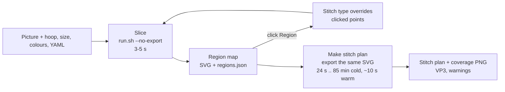

# Web UI feasibility: slice a picture in the browser

Status: contract decided in an interview on 2026-10-11/12. The operator confirmed
the shared understanding and the proposals D11, D12 and the `export_svg.sh`
extraction on 2026-10-12. Implementation started on branch `feat/webui`. Implementation, subagents and later sessions work from this file, not from
the conversation.

## Verdict

- **Feasible, medium size**, if the operator picks a stitch type per Region and
  presses Slice. Estimate: about 3 to 4 agent-days, roughly 1,200 to 1,600 lines
  with tests (an estimate from the task list below, not a measurement).
- **Not feasible cheaply**: drawing satin columns freehand. That is a digitizing
  editor (rails, rungs, direction, order). Inkscape with Ink/Stitch already is one.
- **The hard limit is export time.** The real Stitch plan needs the Ink/Stitch
  VP3 export, which took 24 s to 85 min cold on patch-sized designs. The UI cannot
  update the stitch plan live like a 3D-print slicer. It shows a fast Region map
  instead and makes the Stitch plan on request.
- **One pipeline change is needed**: `vectorize.py` chooses satin per colour
  today (`satinize.colors`). A choice per Region needs a new override input.

## Measured facts

Measured 2026-10-11/12 on the committed pipeline (HEAD `ea82c5b`, extracted with
`git archive` to a scratch folder), `.venv/bin/python` 3.13, 12 cores, each export
with its own fresh `XDG_CONFIG_HOME` so the Ink/Stitch cache started empty.

| Step | Skyfowl, 75 mm, 88 objects | Bomb, 90 mm, 724 objects |
|---|---|---|
| Vectorize (picture to Ink/Stitch SVG) | 3.0 s | 4.6 s |
| VP3 export, cold cache | 24.4 s, 23.7 s (two runs) | 5,085 s (85 min) |
| VP3 export, warm cache, SVG unchanged | 8.5 s, 9.5 s | 11.4 s |
| Warm cache, one fill's `row_spacing_mm` changed | 10.7 s | not measured |

Inputs: `input/Skyfowl_patch.webp` with `patch_descriptions/skyfowl_75.yaml
--size-mm 75`, and `input/Bomb_patch.webp` with `patch_descriptions/bomb_web.yaml
--size-mm 90`. Caveat on the Bomb number: another session's Ink/Stitch export ran
on the machine at the same time. Each export is single-threaded, so this is
unlikely to explain much, but it was not ruled out.

What the numbers show:

- Ink/Stitch caches per element. Changing one attribute on one path cost 10.7 s,
  close to the 9.5 s warm floor, not the 23.7 s cold cost. The warm floor is
  mostly Ink/Stitch start-up.
- Re-export after a real override is **not measured yet**. A toggle can also
  change neighbouring fills (underlap) and trims, which may miss the cache. At
  Bomb's average of about 7 s per object, a few misses cost tens of seconds and
  many cost minutes. Measurement M1 below closes this.

Facts read from the code this session:

- Object ids are sequential (`f{idx}`, `s{idx}`, `r{idx}` in `vectorize.py`
  `emit_svg`), so they change between runs and cannot key an override.
- The emitted SVG's `viewBox` is the source picture's own pixel grid
  (`viewBox="0 0 {W} {H}"`, `load_image` does not resample). A click on the Region
  map is a point in picture pixels, valid across hoop, size and colour changes.
- `satinize.component_to_satins` already covers a wide Region with parallel
  strips (`_strip_rows`), capped by `max_rows` (3) × `max_row_mm` (4.5 mm), then
  checks coverage (`min_coverage` 0.9) and spill (`max_overhang` 0.45). Values are
  the `vectorize.py` `build_settings` defaults, changeable in YAML `satinize:`.
- Precedence is CLI flag > YAML key > profile > default (`build_settings`
  docstring). Hoop, size and colour count are CLI-only. A YAML `palette:` makes
  `--colors` ignored with a note (`build_palette`).
- Flask 3.1.3 is already pinned in `requirements.lock` (Ink/Stitch needs it).
- `wizard/core.py` already has the job machinery to reuse: `slugify`,
  `_make_base`, `_run_pipeline`, `_kill_group` (process-group cancel),
  `stage_label` (plain-words progress), `edge_warnings`, `pipeline_args`.
- `qa/export.sh` wraps the export in `timeout 1800`, which would kill a Bomb-class
  export at 30 min. Do not reuse it for the web UI.

## Terms

`GLOSSARY.md` holds the language. This work added **Region**, **Stitch type
override**, **Slice** and **Region map**, and uses the existing **Stitch plan**.
The operator's word "preview" maps to two things: the Region map (seconds, no
stitches) and the Stitch plan (after export).

## Decisions

| # | Decision | Why |
|---|---|---|
| D1 | The operator clicks a Region and sets it to Fill or Satin, or clears it back to the pipeline's choice. No brush painting, no freehand satin. | One Region is one pipeline object, so the override maps cleanly. Painting needs Region splitting; freehand is a digitizing editor. |
| D2 | A Satin override has no row cap: a Region gets ceil(width / `max_row_mm`) parallel rows. The coverage test stays. A Region the rows can't cover stays a fill and is reported as refused, with the coverage %. | Operator asked that wide Regions get several satin rows. Keeping the test stops gaps and spill from reaching the fabric. |
| D3 | Only fill Regions and satinized Regions are clickable. Outline satins, the Satin border and Gradient regions are drawn but locked. | One code path (`fill_components` + `satinize`). Thin outlines as fills are a known Hotspot source. |
| D4 | Two buttons. **Slice** runs only key-background and vectorize (about 3 to 5 s) and shows the Region map. **Make stitch plan** exports the Slice's SVG to VP3 and shows the Stitch plan. | Export takes 24 s to 85 min cold; the fast loop must not wait for it. |
| D5 | Input is a raster picture only (WebP, PNG, JPG). | The request is "load an image". Layered SVG users already work in Inkscape. |
| D6 | Settings: the guided wizard's three (hoop, Patch size, colour count) plus an optional YAML config. Colour count is greyed out when the YAML pins a `palette:`. | Reuses wizard values; every advanced key (palette, gradients, profile) already lives in the operator's YAML files. |
| D7 | An override is keyed by a point in picture pixels only, stored in the job YAML as `stitch_overrides:`. It applies to whatever fill Region holds that point at the next Slice. | Survives palette and colour-count changes. `run.sh --config job.yaml` reproduces the Slice from the terminal. |
| D8 | Flask plus plain HTML/JS, no build step, bound to 127.0.0.1. One job at a time with Cancel. | No new dependency; cheap-model agents can edit one file without a toolchain. |
| D9 | Two review pauses: after T1 (go/no-go) and after the end-to-end run. | Stops early if satin overrides or re-export time disappoint, before UI work is merged. |
| D10 | Tasks T1 to T3 are written by `opencode/space-bunny-free` (fallback `opencode/deepseek-v4.1-flash`) and checked by a fresh Sonnet critic that reruns the tests itself. T4 is run by the main session. | AGENTS.md defaults; cheap-model code and its tests can agree and both be wrong. |
| D11 | Make stitch plan exports the exact SVG the last Slice wrote; it does not re-run vectorize. There is no automatic second fit pass (the wizard does one); overshoot is shown as a warning. | The Stitch plan must belong to the Region map on screen. A second pass doubles an export that can take 85 min. |
| D12 | The Stitch plan pane is not pan/zoom-synced with the picture. The picture and Region map panes are. | Picture and Region map share one pixel grid; the stitch plan PNG has its own mm scale, margin and header (`preview.py`), so syncing it is extra work for little gain. |

## How it works



## Interfaces

These are fixed so T2 and T3 can start against a fixture before T1 lands.

### YAML key (read by `vectorize.py`)

```yaml
stitch_overrides:          # optional; absent or [] = today's behaviour exactly
  - at_px: [412, 310]      # point in source picture pixels, x right, y down
    type: satin            # satin | fill
  - at_px: [128, 95]
    type: fill
```

### Result sidecar `<base>.regions.json` (written by `vectorize.py` next to the SVG)

```json
{
  "picture_px": [1024, 1024],
  "objects": [
    {"id": "f12", "kind": "fill", "color": "#ddb97f"},
    {"id": "s40", "kind": "satinized", "color": "#bc7d28", "override": 0},
    {"id": "s51", "kind": "outline", "color": "#080606"}
  ],
  "overrides": [
    {"at_px": [412, 310], "type": "satin", "status": "applied", "rows": 5, "objects": ["s40", "s41"]},
    {"at_px": [128, 95], "type": "satin", "status": "refused", "reason": "rows cover 61%, needs 90%"},
    {"at_px": [5, 5], "type": "fill", "status": "orphaned", "reason": "background"}
  ]
}
```

`kind` is one of `fill`, `satinized`, `outline`, `border`, `gradient`, `run`.
`status` is one of `applied`, `refused`, `orphaned`, `shadowed`. `override` is the
index into `overrides` that produced the object, when one did.

### HTTP API (Flask, `tools/digitize/web/server.py`)

| Route | Does |
|---|---|
| `GET /` | the page (`static/index.html`); `/static/<file>` serves the rest |
| `GET /api/options` | the wizard's choices |
| `POST /api/picture` | upload a picture; runs the wizard picture check; starts a new job; the page clears overrides (E5) |
| `POST /api/yaml` | parses YAML text: valid or not, whether it pins a palette, any `stitch_overrides` in it |
| `POST /api/slice` | writes `job.yaml`; runs Slice in the background |
| `POST /api/stitchplan` | exports the last Slice's SVG in the background |
| `POST /api/cancel` | kills the running job's process group |
| `GET /api/status` | the whole state the page draws from; the page polls it about once a second while a job runs |
| `GET /files/<slug>/<name>` | one file directly inside `output/web/<slug>/`; `<name>` must match `^[A-Za-z0-9._-]+$` |

Errors are always `{"error": "<plain words>"}`. 409 means a job is running (E6).

```text
GET  /api/options  -> 200 {"hoops": [[120, 120], [260, 200]], "default_hoop": 0,
                           "default_size_mm": 100, "colors": [4, 6, 8], "default_colors": 6}

POST /api/picture  multipart/form-data, field "picture" (png, jpg, jpeg, webp)
                -> 200 {"slug": "skyfowl-patch", "url": "/files/skyfowl-patch/picture.webp",
                        "width": 1024, "height": 1024,
                        "kind": "transparent" | "plain_background" | "busy_background",
                        "background_hex": "#fefffe" or "", "advice": ["..."]}
                   400 bad file, 409 busy
                   Creates output/web/<slug>/ fresh (a folder with the same slug is
                   replaced), saves picture.<ext>, forgets the previous Slice and
                   Stitch plan.

POST /api/yaml     {"yaml_text": "..."}
                -> 200 {"ok": true, "has_palette": true, "stitch_overrides": [...]}
                   200 {"ok": false, "error": "line 3: ..."}

POST /api/slice    {"hoop": [120, 120], "size_mm": 100 or null, "colors": 6,
                    "key_background": false, "yaml_text": "" or "...",
                    "overrides": [{"at_px": [412, 310], "type": "satin"}]}
                -> 202 {"slice_id": 3}; 400 no picture, bad body or bad YAML; 409 busy
                   job.yaml = the YAML mapping (or {}) with stitch_overrides set to
                   "overrides"; the key is left out when the list is empty, so G1 holds.

POST /api/stitchplan  (no body)
                -> 202 {"slice_id": 3}; 400 {"error": "no Slice yet"}; 409 busy

POST /api/cancel   -> 200 {"cancelled": true | false}

GET  /api/status -> 200
{
  "state": "idle" | "slicing" | "exporting" | "failed" | "cancelled",
  "stage": "Making the embroidery file" or null,      # core.stage_label
  "elapsed_s": 12.3 or null,
  "log_tail": ["last 20 pipeline lines"],
  "error": null or "plain words",
  "picture": null or {"slug": "...", "url": "...", "width": 1024, "height": 1024},
  "slice": null or {"slice_id": 3,
                    "svg_url": "/files/<slug>/slice.svg?v=3",
                    "regions_url": "/files/<slug>/slice.regions.json?v=3" or null,
                    "posterized_url": "/files/<slug>/slice_posterized.png?v=3" or null,
                    "overrides": [... as sent with that Slice]},
  "stitchplan": null or {"slice_id": 2,
                    "stitchplan_url": "/files/<slug>/plan_stitchplan.png?v=2",
                    "coverage_url": "/files/<slug>/plan_coverage.png?v=2",
                    "vp3_url": "/files/<slug>/plan.vp3?v=2",
                    "stitches": 17065, "width_mm": 69.5, "height_mm": 75.8,
                    "threads": ["#ddb97f", "..."], "warnings": ["..."],
                    "removed_by_precheck": ["s40"]}
}
```

The Stitch plan is stale (E7) when `stitchplan.slice_id` differs from
`slice.slice_id`. The Region map is stale (E8) when the page's override list
differs from `slice.overrides`; the page tracks that itself.

Until T1 lands there is no `slice.regions.json`. The page then reads each
object's kind from the SVG itself: parent group id `border` is `border`,
`outlines` is `outline`, a `fill:url(#...)` style is `gradient`, a path with
`inkstitch:satin_column` inside a `color<N>` group is `satinized`, an id starting
with `r` is `run`, anything else is `fill`.

Job folder files, fixed names: `picture.<ext>`, `job.yaml`, `slice.svg`,
`slice.regions.json`, `slice_posterized.png`, and for the Stitch plan `plan.svg`
(a copy of `slice.svg` the precheck may edit), `plan.vp3`, `plan_stitchplan.png`,
`plan_coverage.png`, `plan.zip`, `plan.err`. `removed_by_precheck` is the path ids
in `slice.svg` that are missing from `plan.svg` after the precheck.

## Edge-case rules

| # | Case | Rule |
|---|---|---|
| E1 | Two overrides land in one Region | Clicking a Region that has one replaces it. In YAML the last entry wins; the earlier one is `shadowed`. |
| E2 | Point lands on an outline satin, the border, a Gradient region, a skipped colour, a dropped speck or background | `orphaned` with that reason; nothing changes. |
| E3 | Satin rows fail coverage or spill | Region stays a fill; `refused` with the coverage %. |
| E4 | Fill override on a Region that YAML `satinize.colors` would satinize | The override wins: fill. |
| E5 | A different picture is loaded | All overrides are cleared. Hoop, size, colour or YAML changes keep them. |
| E6 | Slice or Make stitch plan while a job runs | One job at a time; buttons disabled; Cancel kills the process group. |
| E7 | A new Slice after a Stitch plan exists | The Stitch plan is marked stale. |
| E8 | Overrides changed without a new Slice | The Region map is marked stale. |
| E9 | Very large picture (review R4-12: 6000 px runs for minutes) | Elapsed time and stage are shown; no hard limit; the wizard's resolution advice is reused. |

## Tasks

Every task works in its own worktree, `.claude/worktrees/webui-<task>` on branch
`feat/webui-<task>` from fresh `origin/master`, commits locally and never pushes or
merges. A fresh worktree lacks the gitignored runtime, and `run.sh` and
`regress.sh` resolve paths from the worktree root. So, as the existing worktrees
do (`fit-mm`, `gradient-fill`), symlink these from the main checkout into the
worktree root: `.venv`, `inkstitch`, `input`, `patch_descriptions`. Also create
`work/` in the worktree and symlink `work/book_burner.yaml` into it (`regress.sh`
reads it). Implementation runs as `opencode run -m opencode/space-bunny-free --auto`
inside that worktree, told the files it may write. On an API or rate-limit error,
retry with `opencode/deepseek-v4.1-flash`. A fresh Sonnet critic then reruns the
task's acceptance checks itself and reports what it reproduced.

| Task | Size (estimate) | Depends on | Model |
|---|---|---|---|
| T0 rail-satin change lands on master | not ours | | |
| T1 overrides in the pipeline | M-L, about 1 day with review | T0 | space-bunny-free, Sonnet critic |
| T2 server | M, 0.5 to 1 day | interfaces above; T0 for the `run.sh` edit | space-bunny-free, Sonnet critic |
| T3 browser page | M-L, about 1 day | interfaces above | space-bunny-free, Sonnet critic |
| T4 end-to-end check and docs | S, 0.5 day | T1, T2, T3 | main session |

T2 and T3 run in parallel with T1, against a hand-written `regions.json` fixture.

### T0. Prerequisite (owned elsewhere)

The main checkout carries another session's uncommitted satin work (seen
2026-10-12): `tools/digitize/vectorize.py` (new `rail_satin` settings,
`BLOB_WIDTH_RATIO`), `skeleton.py`, `run.sh` (a `--satin-taper` flag), `docs/USAGE.md`,
a new `tools/digitize/glyph_satin/` folder and `tests/test_rail_satin.py`. It
touches the same code T1 changes, for the same blob-shaped Regions that satin
overrides get refused on. T1, and T2's `run.sh` edit, start only after that work is
merged to master, or after the operator says to start without it. Do not touch
those files in the main checkout.

### T1. Stitch type overrides in `vectorize.py`

Files: `tools/digitize/vectorize.py`, `tools/digitize/satinize.py` (only if the row
cap must become a parameter), new `tools/digitize/tests/test_stitch_overrides.py`,
`docs/USAGE.md` (one YAML section).

- Parse `stitch_overrides:`; reject a bad entry with a warning, like other keys.
- Resolve each point against the colour label map before compensation: the
  colour at that pixel, then the fill component of that colour containing it.
  Report `orphaned` with the reason from E2 when there is none.
- Satin: call `component_to_satins` with `max_rows` lifted to
  ceil(width / `max_row_mm`) for this Region only. On `None`, report `refused` with
  the coverage %. Fill: skip satinize for this Region.
- Write `<base>.regions.json` (schema above). With no `stitch_overrides`, the SVG
  must stay byte-identical (G1); the sidecar is an extra file.

Acceptance: unit tests on synthetic shapes: a 10 × 3 mm capsule becomes one
satin; a 20 mm wide plate gets 5 rows; a crescent is refused with its coverage %;
E1 (last wins, `shadowed`), E2 (each orphan reason), E4 (fill beats
`satinize.colors`). G1 and G2 pass. Then measurement M1.

### T2. Local server

Files: new `tools/digitize/web/server.py`, `tools/digitize/web/__init__.py`, new
`tools/digitize/export_svg.sh`, `tools/digitize/run.sh`, `digitize.py` (add `web`
next to `setup` and `doctor`), new `tools/digitize/tests/test_web_server.py`.

- `python3 digitize.py web [--port N]` starts Flask on 127.0.0.1, default 8765.
- Slice: `run.sh --no-export` with `core.pipeline_args(...)` and
  `--config output/web/<slug>/job.yaml` (operator YAML plus `stitch_overrides`),
  under a unique base from `core._make_base`, then move the SVG, sidecar and
  `_posterized.png` into the job folder.
- Make stitch plan: copy `run.sh` lines 140 to 181 (satin precheck, Ink/Stitch
  export, unzip, `trim_vp3.py`, two `preview.py` renders, jam check) into
  `export_svg.sh <svg> <out_prefix> [--background HEX]`. It fixes the SVG in place
  and writes `<out_prefix>.vp3`, `<out_prefix>_stitchplan.png`,
  `<out_prefix>_coverage.png`, `<out_prefix>.zip` and `<out_prefix>.err`, and echoes
  the same `== ...` stage lines as `run.sh`. The server copies `slice.svg` to
  `plan.svg` and calls it with prefix `output/web/<slug>/plan`. The preview
  background follows `run.sh`: YAML `fabric_color:`, else `#101010` for profile
  `vadmel`, else white. No timeout; Cancel stops it. Switching `run.sh` itself to
  call `export_svg.sh` waits for T0 (it is the `run.sh` edit), then G1b. Then measure the VP3 with `wizard/vp3.py` and report `core.edge_warnings`
  against the hoop.
- The satin precheck (`qa/satin_precheck.py --fix`) deletes satin columns that
  would crash the export, which can silently undo an applied Satin override.
  Report every removed path id against `regions.json` object ids, and the UI marks
  those Regions "removed by precheck" on the Stitch plan.
- One job at a time (a lock); Cancel uses `core._kill_group`.

- `create_app(root, run_sh=None, export_sh=None, out_root=None)` builds the app, so
  tests inject fake scripts and a temporary output folder.

Acceptance: Flask test-client tests for every route with fake run and export
scripts; G3, G4; G5 with a fake export script that starts a grandchild
(`sleep 300 &`) and waits, so a cancel that kills only the leader fails the test;
a test where `plan.svg` loses a satin path and the status lists it in
`removed_by_precheck`; a path-traversal request to `/files/` is refused. G1b runs
later, with the `run.sh` switch after T0. G5 on a real Bomb export is part of T4.

### T3. Browser page

Files: new `tools/digitize/web/static/index.html`, `app.js`, `app.css`.

- Left: settings (hoop 120 × 120 or 260 × 200, size, colours 4/6/8, Load YAML),
  picture upload, Slice, Make stitch plan, Cancel, progress (stage and elapsed).
- Right: split view. Picture and Region map side by side with synced pan and
  zoom (same pixel grid). The Region map is the emitted SVG inlined, styled from
  `regions.json`: satin and satinized marked, refused outlined, locked objects
  dimmed. A Stitch plan tab shows the two PNGs, not synced (D12).
- Clicking a fill or satinized Region opens Fill / Satin / Clear. The click point
  converts to picture pixels with `getScreenCTM().inverse()`. An override list shows
  each entry's status and reason. Stale marks per E7 and E8.

Acceptance: works on the fixture with the server stubbed; no console errors in
Firefox; the page loads nothing from the network except its own files.

### T4. End-to-end check and docs

Main session, after T1 to T3 are merged into one integration branch.

- Drive Firefox through the firefox-devtools MCP: load Skyfowl with
  `skyfowl_75.yaml`, Slice, click a fill Region, set Satin, Slice, confirm the map
  shows it satin, Make stitch plan, take screenshots of each step.
- `docs/USAGE.md`: a "Web UI" section. `README.md`: one line under Quick start.

## Verification plan

Guarantees and the test that would fail if each were false:

| # | Guarantee | Falsifying test |
|---|---|---|
| G1 | Without `stitch_overrides` the pipeline output does not change | In T1's worktree, run `tools/digitize/qa/regress.sh <scratch>/base --vectorize <copy>`, where `<copy>` is the parent commit's `vectorize.py` with its `skeleton.py` and `satinize.py` beside it (the method in `regress.sh`'s header). Then run `regress.sh <scratch>/new`. `sha256sum` of every `.svg` and `.vp3` must match pairwise for the 3 designs (book burner, goat, earth). About 80 s per run. |
| G1b | T2's `run.sh` refactor does not change output | `run.sh` on Skyfowl (`skyfowl_75.yaml`, `--size-mm 75`) at T2's parent commit and at T2's commit: SVG, VP3 and both PNGs byte-identical. `regress.sh` does not call `run.sh`, so G1 does not cover this. |
| G2 | An override survives a size change | Slice Skyfowl at 75 mm and at 100 mm with one `at_px`; the same Region comes out satin both times. |
| G3 | The server is reachable only from this machine | A connection to the machine's LAN address on the port is refused; 127.0.0.1 answers. |
| G4 | One job at a time | Two concurrent Slice requests give exactly one 202 and one 409. |
| G5 | Cancel leaves no pipeline process behind | Start Make stitch plan on Bomb, cancel, and check that no process of that process group (including `inkstitch.py`) is still alive. |

Measurement M1 (end of T1): re-export time after one real Satin override on
Skyfowl and on Bomb, warm cache, against the warm floors above (9.5 s and 11.4 s).
This is a go/no-go input at pause 1.

Test command: `.venv/bin/python -B -m unittest discover -s tools/digitize/tests`.

Review pauses:

1. **Pause 1, after T1**: the operator sees the unit tests, G1, G2, M1 and the
   Stitch plan of Skyfowl with one wide Region forced to satin. Go or stop.
2. **Pause 2, after T4**: the operator sees the screenshots and tries the page
   locally. Nothing is merged to master or pushed without the operator's word.

## Pinned values

The only source of truth for identifiers during implementation. Environment
values (port, folders) are flags or config, never hardcoded.

| Name | Value |
|---|---|
| Design contract | `docs/design/webui.md` |
| Start command | `python3 digitize.py web [--port N]` |
| Bind address | `127.0.0.1` |
| Default port | `8765` (free per `ss -ltn` on 2026-10-11) |
| Code folder | `tools/digitize/web/` (`server.py`, `static/index.html`, `static/app.js`, `static/app.css`) |
| Shared export recipe | `tools/digitize/export_svg.sh` |
| Job folder | `output/web/<slug>/` (`output/` is gitignored), slug from `wizard.core.slugify` |
| Job config | `output/web/<slug>/job.yaml` |
| YAML key | `stitch_overrides: [{at_px: [x, y], type: satin\|fill}]` |
| Result sidecar | `<base>.regions.json` next to the SVG |
| Hoops | 120 × 120 mm, 260 × 200 mm (`wizard/core.py` `HOOP_SMALL`, `HOOP_LARGE`) |
| Default Patch size | 100 mm (`DEFAULT_SIZE_MM`) |
| Colour choices | 4, 6, 8 (`COLORS_FEWER`, `COLORS_AUTO`, `COLORS_MORE`) |
| Satin row width | `max_row_mm` 4.5, `min_coverage` 0.9, `max_overhang` 0.45 (YAML `satinize:`) |
| Python | `.venv/bin/python` (3.13) |
| Web framework | Flask 3.1.3 (`requirements.lock`) |
| Test command | `.venv/bin/python -B -m unittest discover -s tools/digitize/tests` |
| Worktrees, branches | `.claude/worktrees/webui-<task>`, `feat/webui-<task>`, from `origin/master` |
| Implementer model | `opencode/space-bunny-free`, fallback `opencode/deepseek-v4.1-flash` |
| Critic model | `claude-sonnet-5-5`, fresh agent per review |
| Worktree symlinks | `.venv`, `inkstitch`, `input`, `patch_descriptions`, `work/book_burner.yaml`, all to the main checkout |
| G1 reference designs | `input/patch_book_burner.jpg` + `work/book_burner.yaml`; `input/nano_banana/midnight-epicure.png` + `patch_descriptions/border_black.yaml`; `input/earth.jpg` (`regress.sh` lines 116 to 118) |
| Timing references (local only, gitignored) | `input/Skyfowl_patch.webp` + `patch_descriptions/skyfowl_75.yaml` at 75 mm; `input/Bomb_patch.webp` + `patch_descriptions/bomb_web.yaml` at 90 mm |

## Out of scope (deferred)

- Brush painting and freehand satin columns.
- Overrides on outline satins, the border or Gradient regions.
- Layered SVG input.
- A palette editor in the browser (the next step after this; `make_config.html`
  had one, and the repo cleanup deletes that file).
- Automatic export in the background after each Slice.
- Synced pan and zoom for the Stitch plan pane.
- Satin row direction chosen by the operator (rows follow the Region's long axis).
- Several jobs or several operators at once.

## Risks

- **Re-export after a toggle** may miss the cache widely (M1 measures it).
- **Straight strip rows** on a wide Region are untested on fabric: they look
  like a woven block, not a shaped satin. Judge them at pause 1.
- **Merge conflict with T0**: T1 and the rail-satin change edit the same functions.
- **Repo cleanup** (`patch_descriptions/design/repo-cleanup-contract.md`) moves
  `GLOSSARY.md` to `docs/GLOSSARY.md`; the four new terms are uncommitted edits in
  the main checkout and must travel with it. Its rule against reorganising `tools/`
  keeps the paths above valid.

## Separate issues found

- Bomb's cold export took 85 min at 90 mm and 724 objects, against ADR 0002's
  488 s for the 260 mm Scavenger's Daughter. Worth its own profile.
- `qa/export.sh` has `timeout 1800`, which kills any export over 30 min.
